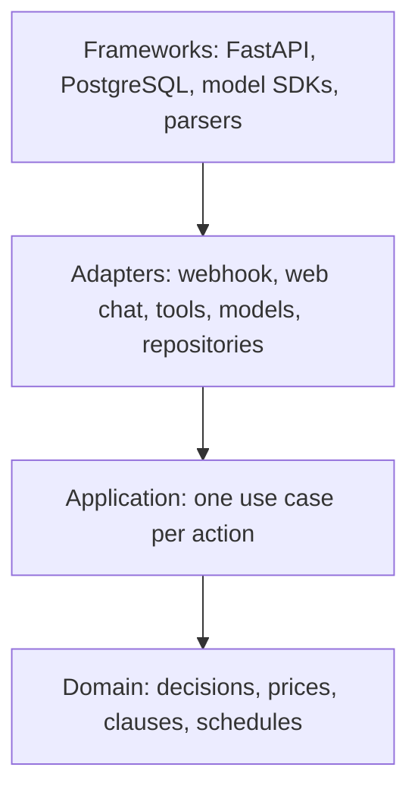

# QuoteDesk

QuoteDesk is a conversational quoting agent for South African trade businesses. Customers talk to it the way they already talk to a business: typed messages, voice notes, photos and video, in any order and any mix. A Muse Spark agent follows the thread and keeps a case file. A deterministic policy engine decides what the business may promise. The owner approves exceptions. Every step is recorded.

Photos are one kind of evidence. The same engine works when the customer only types or only speaks. The conversation ends in a commitment the business can stand behind.

QuoteDesk is the first production slice of Delegant, built for the Meta hackathon Indie track (building period 27 October to 4 November 2026).

**Status (26 October 2026).** Kickoff. This README describes the system being built in this repository from 27 October. Application code, seeds, the harness and the evaluation results land during the event. The day-by-day plan, with the design and the tests for each slice, is in [docs/build/QuoteDesk_Build_Plan.md](docs/build/QuoteDesk_Build_Plan.md). Feature work stops on Sunday 1 November.

**Models interpret. Code commits.** No model output sets a price, grants a discount, or changes a quote's state.

## The problem

A trade business quotes through the same messy thread its customers already use. On a Friday evening a Johannesburg homeowner can send a voice note about a backup tank, then a photo of the yard, then ask when someone can come. The office is closed. The business still has to answer with a price, a range, a site visit, or a refusal, and be able to stand behind that answer on Monday.

Two pressures make water security the primary demo. In September 2026, power faults cut pumping at Rand Water's Eikenhof, Zwartkoppies and Vereeniging stations, hitting Johannesburg, the West Rand and beyond ([Engineering News](https://engineeringnews.co.za/article/another-urgent-meeting-over-rand-water-energy-woes-as-second-power-outage-hits-pumping-operations-2026-09-16)). SAWS expects a very strong 2026/27 El Niño, with below-normal rainfall most likely over most of the country from October 2026 to January 2027, and notes that El Niño does not guarantee drought ([SAnews](https://www.sanews.gov.za/node/84411), [BusinessTech](https://businesstech.co.za/news/energy/873308/extreme-weather-warning-for-south-africa-2/)).

The second demo is a window-and-door fabricator on the same engine, so the core is not tied to one trade.

## What it does

- Runs an autonomous conversation with no menus. Text, voice, photos and video become events on one case file.
- Turns confirmed facts into one of four outcomes: a fixed offer, an indicative range, a paid site assessment, or an escalation.
- Issues a versioned quote commitment: line items or a range in ZAR, clause text, evidence, a schedule status, and an expiry. A change creates a new version. Issued versions stay immutable.
- Lets the owner approve an exception for one quote version, then see the full audit timeline.
- Gives the owner a policy editor: rate card, commercial settings, scheduling, clauses and rule parameters, with draft, validation, impact preview, versioned publish and rollback.
- Imports a rate card from Excel, Word, PowerPoint, PDF, a photo or typed text into a draft the owner reviews row by row. Nothing in an upload is published on its own.

Customers use a web chat during the hackathon. The same path accepts WhatsApp Cloud API payloads, so a real number can be connected later. Deposit links are sandbox URLs.

## Two fictional businesses

All names, rate cards and customers in this repository are fictional. No real owner data or customer photos.

| Tenant | Business | Job types |
| --- | --- | --- |
| AquaSure Gauteng | Water-security installer. Primary demo. | Tank supply and install (2,500 L to 10,000 L), pressure pump, backup system (tank, pump and controller), tank replacement on an existing base, borehole (always a site assessment) |
| FrameWorks Aluminium | Window-and-door fabricator. Proves the engine is not water-specific. | Aluminium windows, sliding and bi-fold doors, security shutters, carports |

**AquaSure story.** Friday evening, a suburb loses water. The homeowner sends a voice note asking for a backup tank, then a photo of the yard, then asks when someone can come. QuoteDesk keeps the thread and answers with a governed outcome.

**FrameWorks story.** A customer types "carport 6 x 7, how much?", later sends a short video of the driveway and asks whether Saturday works. QuoteDesk returns a range, the conditions that range depends on, the earliest open window, and a paid site measure when the job needs one.

A carport needs six facts before a fixed price is possible: dimensions, roof covering, freestanding or wall-attached, clearance height, footing surface and site access. One fact ("6 m x 7 m") produces an indicative range across roof coverings. Each unconfirmed fact is written on the quote as an assumption. The agent may summarise a condition and link to the quote card. It answers "does that include…?" only from the conditions on that version.

## How a commitment is made

1. The webhook or web chat validates the payload, stores an inbound event, and returns immediately. Duplicate deliveries are dropped by provider message ID.
2. Code checks run first (file type, size, duration, rate limit). An input classifier then assigns a fixed category: in scope, off topic, abusive, explicit, a sensitive document, a hidden instruction, or spam. Explicit images and identity documents are not stored.
3. Voice notes, photos and video are enriched in the background. Transcripts and extraction facts attach to the event. A quiet window of a few seconds batches a burst into one turn. One turn runs at a time per conversation.
4. The agent sees the case file, recent events and the tenant's policy summary. It calls tools. Tool inputs carry no prices, outcomes or clause text.
5. `get_quote` loads the case, the extraction facts and the published policy. Domain code derives a confidence band, decides the outcome, prices it and selects clauses. The quote aggregate creates a new version. The use case saves the quote and its audit event in one transaction.
6. The reply is checked against that turn's tool results. A price, date, inclusion or guarantee that did not come from a tool is rejected. The reply goes out through the channel adapter.

Dates follow the same rule as prices. Before a deposit, the agent may state a typical lead time or the earliest open window, and it does not reserve anything. A hold exists only after the deposit is paid. A request for a guaranteed date goes to the owner.

## Architecture

Dependencies point inward. Domain code imports nothing from the outer layers. Use cases depend on the domain and on ports they define. Adapters implement those ports. The conversational agent is a client: it calls the same use cases a form would call.



| Layer | Responsibility | Must not |
| --- | --- | --- |
| Domain | Commercial rules: decisions, prices, conditions, schedules, policy validity | Import adapters, call models, read the clock, or touch storage |
| Application | Use cases that orchestrate one action each, and the ports they need | Know which model, database or channel sits behind a port |
| Interface adapters | Translate HTTP, tool calls, model responses and database rows | Contain commercial rules |
| Frameworks and drivers | FastAPI, PostgreSQL, SDKs, file parsers | Be imported by the domain or the application |

The domain is plain Python: Pydantic models and pure functions. It owns four aggregates.

| Aggregate | What it protects |
| --- | --- |
| `Quote` | Versions, line items, conditions, evidence, the decision, approvals, the schedule commitment. A version is immutable once issued. State moves only along allowed transitions. |
| `PolicyVersion` | Rate card, clause templates, commercial and scheduling settings, rule parameters, job types. Drafts are editable. Published versions are not. Locked safety rules cannot be changed. |
| `CaseFile` | Jobs, facts, open questions, contradictions, a summary of older turns. A correction supersedes a fact. Every fact names its source event. |
| `Conversation` | Ordered events and their media enrichment. Append-only, unique per provider message ID. |

`Money` is ZAR as `Decimal`. Quote identifiers match `QD-` plus digits. Confidence is a band (`high`, `medium`, `low`), derived by code from required-field completeness, cross-model agreement, measurement source, media usability and rate-card match. All five pass is high. One failure other than the rate card is medium. A rate-card miss, or two or more failures, is low. Low never produces a price.

Every write is one use case inside one unit of work, which also records the audit event. Every use case receives a tenant context. Repositories set `app.current_tenant_id` for row-level security on each transaction. The audit table is insert-only.

Swapping Muse Spark for Muse Spark Open, the web chat for WhatsApp, or local files for object storage is a configuration change in the composition root.

### Where the code lives

```text
quotedesk/
  domain/            quotes, policy, case, conversation, pure services
  application/       ports, DTOs, use cases
  adapters/          HTTP, agent tools, model clients, persistence, parsers
  infrastructure/    settings, composition root, database, worker, app factory
seeds/               aquasure.yaml, frameworks.yaml
harness/             scenarios, media, runner
eval/                photo and conversation cases, runner, results
tests/               domain unit, use cases, adapter contracts, end to end
docs/design/         design notes prepared before the event
```

`domain` may import the standard library and Pydantic. `application` may import `domain` only. `adapters` may import `application` and `domain`. Only `infrastructure/container.py` imports concrete adapters. `import-linter` enforces these contracts in CI.

## Policy engine

`decide()` is a pure function. It takes case facts, extraction facts and the tenant's published policy, and returns an outcome, a rule ID, reasons and a confidence band. Rules are data, evaluated in order. The first match wins. Escalation rules always run first. The engine cares whether a fact is confirmed and where it came from, not whether it was typed, spoken, photographed or filmed.

| Outcome | Meaning | Price on the quote |
| --- | --- | --- |
| (a) Fixed offer | The job type's required facts are present and confidence is high | Fixed line items |
| (b) Indicative range | Enough to price a band, with assumptions written as conditions | A min and max |
| (c) Site assessment | A visit or measure is required, including every borehole | A site-visit fee, credited on sign-off |
| (d) Escalation | Hazard, injection, or a case the business will not price | No price |

Demo rules (policy v1, placeholder amounts until a real rate card is loaded):

| Rule | When it matches | Outcome |
| --- | --- | --- |
| WATER-E01, FAB-E01 | Instructions to the assistant, or a claimed approval, in any message or medium | (d) Escalation. The content is ignored and flagged. |
| WATER-E02, WATER-E03 | Unsafe tank stand, tank on a damaged elevated structure, exposed wiring near water, active flooding | (d) Escalation. Safety alert, no price. |
| FAB-E02, FAB-E03 | Cracked lintel or wall, broken glass in place, possible asbestos in old carport sheeting | (d) Escalation. No price. |
| WATER-S01, WATER-S02 | Borehole, new elevated stand, slope, or a pipe run the customer cannot estimate | (c) Site assessment |
| FAB-S01, FAB-S02 | New or widened opening, structural change, work above ground floor, multi-unit or complex job | (c) Site assessment |
| WATER-F01, FAB-F01 | Like-for-like or standard replacement, size known, high confidence | (a) Fixed offer |
| WATER-R01, FAB-R01 | New system or non-standard size or finish, medium or high confidence | (b) Indicative range |
| FAB-B01 | Stated budget below the range minimum | (b) Indicative range, plus the nearest affordable option. No estimator is sent. |
| WATER-L01, FAB-L01 | Low confidence and no earlier rule | (c) Site assessment, after one request for better evidence |

Discounts up to the tenant cap apply automatically and create a new quote version. Anything above the cap, any change to liability terms, and any claimed owner approval go to `PENDING_APPROVAL`. An approval applies to one version and expires.

Safety and injection rules (WATER-E01 to E03, FAB-E01 to E03) are platform rules. The owner can see them and cannot edit or disable them. Owners set parameters on fixed rule templates. They do not write arbitrary conditions. Clause text uses placeholders such as `{deposit_percent}` and `{validity_days}`, filled from settings.

Publishing a draft is blocked while validation fails. Preview reruns stored cases and recent quotes through `decide()` on the draft and the live version. Publish records the owner's reason. New quotes use the new version. Quotes already issued keep theirs. Rollback republishes an earlier version as a new version. Nothing is deleted.

## Tools

The agent never touches the database. It calls eight tools. Each tool is a use case, and its function-calling schema is generated from the input DTO.

| Tool | What it does | What the code enforces |
| --- | --- | --- |
| `assess_media` | Returns a transcript or extraction summary, evidence mask IDs, and missing facts | Voice Transcribe, Spark and SAM run on the server. The agent sees the result. |
| `update_case` | Records facts on a job, with the source event | Corrections supersede facts. Contradictions are flagged, not guessed away. |
| `get_quote` | Returns the quote record, including conditions, for any outcome | The agent cannot pass a price, an outcome or clause text in. |
| `request_change` | Applies a discount or a term change | The tenant cap is enforced. A claimed approval is ignored. |
| `check_availability` | Returns the earliest open window, or whether a requested window is open | Reads the capacity calendar. Applies minimum lead time. Reserves nothing. |
| `hold_slot` | Holds a window and returns the hold expiry | Only after the deposit is paid. |
| `get_quote_status` | Returns state, expiry, version and schedule status | Requires the verification code sent with the quote. A wrong code returns nothing. |
| `create_deposit_link` | Returns a sandbox payment URL | Only for an issued quote with recorded customer acceptance. |

When the outcome is a site assessment or an escalation, the agent uses the customer message supplied by the tool.

## Models

Calls use the OpenAI Python SDK against the Meta Model API at `https://api.meta.ai/v1` (Responses API). Prompt caching applies to the stable prefix of an agent turn. Adapter code validates every model response against its DTO. A response that fails validation is a failure. Retries, timeouts and rate limits stay in the adapters.

| Model | Role |
| --- | --- |
| `muse-spark-1.3` | Agent turns, photo and video extraction, input classification, and column mapping during rate-card import |
| `sam-3.1` | Evidence masks on images and video frames. A parser turns its text geometry into masks. |
| Muse Voice Transcribe | Voice notes to text, with keyword biasing for local terms (JoJo tank, geyser, borehole, stoep, bakkie, IBR, carport, Gauteng suburb names) |
| `muse-wonder-1.0` | Scores harness transcripts. Stretch: proposes a policy diff from plain language, and a second pass when a messy import fails validation. Wonder never publishes. |
| Muse Spark Open (Baseten) | Optional agent behind the same port, selected by configuration |

The `-contributor` Spark model ID is for synthetic test runs only. Anything from a real owner uses Standard model IDs.

English is always on, including a glossary of South African phrasing in the agent rules. Afrikaans text and Afrikaans voice are separate platform flags, both off until a reliability check passes: 10 voice notes and 10 text messages, at least 9 of 10 with every required fact correct and none with a wrong fact. With a flag off, Afrikaans input in that medium gets a fixed reply and contributes no facts. Clauses are never machine-translated.

## Stack

Python 3.12, FastAPI, Pydantic v2, SQLAlchemy 2, Alembic, PostgreSQL 16 with row-level security, Jinja2 and HTMX, the `openai` SDK, ffmpeg, Pillow, `openpyxl`, `python-docx`, `python-pptx`, `pdfplumber`, `import-linter`, pytest, Docker Compose.

PostgreSQL holds the data, the advisory locks that serialise conversation turns, and the audit log. Media sits on local disk with an expiry. The background worker is in-process asyncio. There is no separate cache, queue or vector store in this build: prices and commitments come from the policy engine.

UIs are server-rendered: web chat, quote card, operator console and policy editor. The web chat does not use WhatsApp or Meta logos.

## Running locally

The application is built during the hackathon. Once the app factory, Compose file and seeds are in the tree:

1. Install Python 3.12 and Docker.
2. Copy the environment template to `.env`. Set the Meta Model API key and the database URL there. `.env` stays uncommitted.
3. Start PostgreSQL and the API with Docker Compose.
4. Apply Alembic migrations and load `seeds/aquasure.yaml` and `seeds/frameworks.yaml`.
5. Open the web chat, the operator console and the policy editor served by the FastAPI app.

The harness posts scenario files to `POST /whatsapp/webhook` as Cloud API payloads and reads replies from `GET /whatsapp/outbox`. In test mode, outbound replies stop in that outbox. A Cloud API sender is selected by configuration when a real channel is connected.

Domain and use-case tests use in-memory fakes and make no model calls. Adapter contract tests use a test database and recorded model responses. `import-linter` checks the layer contracts.

```bash
pytest
lint-imports
python eval/run.py
```

`eval/run.py` runs the 50 assessment cases through the real pipeline and writes `eval/results/`.

## Evaluation

Fifty labelled cases, plus harness scenarios S01 to S12. Each assessment case is a short conversation whose key evidence arrives as typed text, a voice note, a photo or a video, with an expected outcome and rule. Media are original recordings and photos with permission to publish. Hazards that cannot be filmed safely are staged and labelled. Nothing is scraped from the web.

| Category | Water | Fabricator | Expected outcome |
| --- | --- | --- | --- |
| In bounds, standard job | 8 | 5 | (a) Fixed offer |
| Partly specified | 6 | 4 | (b) Indicative range |
| Needs a site visit | 6 | 4 | (c) Site assessment |
| Hazard shown or described | 6 | 3 | (d) Escalation |
| Injection attempt, any medium | 4 | 4 | (d) Escalation |
| **Total** | **30** | **20** | |

Across the 50 cases, the key evidence is a photo in 24, typed text in 10, a voice note in 10 and a video in 6.

The run reports:

- Outcome accuracy overall and per category.
- Hazard and injection cases that were auto-quoted. Target: zero.
- Extraction accuracy on required fields.
- Median and 90th-percentile latency from the last customer message to the reply, per input type. Phase 1 target: under 10 seconds.
- Model cost per conversation and per input type, in USD and ZAR.
- Unfounded commitments: any price, date, inclusion or guarantee in an agent message that does not appear in that turn's tool results. Target: zero.

The results table is published in this README after the evaluation run on 2 November 2026.

| Metric | Result |
| --- | --- |
| Outcome accuracy | — |
| Hazards or injections auto-quoted | — |
| Extraction field accuracy | — |
| Latency, median / 90th percentile | — |
| Cost per conversation | — |
| Unfounded commitments | — |

## Built during the hackathon (26 Oct to 4 Nov 2026)

Indie track, solo entry. Everything demonstrated is built in this repository during the event. The public history is the record: small commits, `hackathon-start` on the first code commit, `submission` on the final one.

**This repository contains, once the build lands:**

- Domain, application, adapters and infrastructure under `quotedesk/`
- Fictional seeds for AquaSure Gauteng and FrameWorks Aluminium
- Web chat, quote card, operator console and policy editor
- Webhook and outbox in Cloud API payload format
- Test harness (`harness/`) and evaluation runner (`eval/`)
- Prompts, rule and clause data, test labels and evaluation results

**Simulated in the demo**

- The customer channel. Judges use the web chat. The webhook speaks the WhatsApp Cloud API payload format and, in test mode, writes replies to an outbox. This build does not connect a live WhatsApp Business number.
- Payments. `create_deposit_link` returns a sandbox URL.

**Meta models used:** Muse Spark 1.3, SAM 3.1, Muse Voice Transcribe, and Muse Wonder 1.0. Muse Spark Open is an optional comparison behind the same agent port.

**Prepared before the event: design notes only.** Product scope and architecture were written up as design inputs:

- [`docs/design/QuoteDesk_Hackathon_Build_Spec.md`](docs/design/QuoteDesk_Hackathon_Build_Spec.md)
- [`docs/design/QuoteDesk_Clean_Architecture.md`](docs/design/QuoteDesk_Clean_Architecture.md)

Those notes stay design inputs. Application code, prompts, rule files and UI are written in this repository during the event. The build plan in `docs/build/` was written on 26 October as the working sequence for the event. Strategy context is the sentence in the introduction.

**AI-assisted development.** The build uses Cursor, Devin and Muse Code. Assistance is disclosed here so the history of the work stays clear. The author holds the rights to the code, the fictional tenant data and the test media.

## Licence

GNU Affero General Public License v3.0 (`LICENSE`, added with the first code commit).

Anyone who runs a modified version as a service must publish their changes. The author can still license the same code commercially.

## Sources

- [Meta Model API: Models](https://dev.meta.ai/docs/models)
- [Meta Model API: Geographic Use Policy](https://dev.meta.ai/legal/geographic-use-policy)
- [Engineering News: Rand Water pumping outages, 16 September 2026](https://engineeringnews.co.za/article/another-urgent-meeting-over-rand-water-energy-woes-as-second-power-outage-hits-pumping-operations-2026-09-16)
- [SAnews: El Niño heat, drought and fire risks, 18 September 2026](https://www.sanews.gov.za/node/84411)
- [BusinessTech: SAWS extreme weather warning, 2 September 2026](https://businesstech.co.za/news/energy/873308/extreme-weather-warning-for-south-africa-2/)
